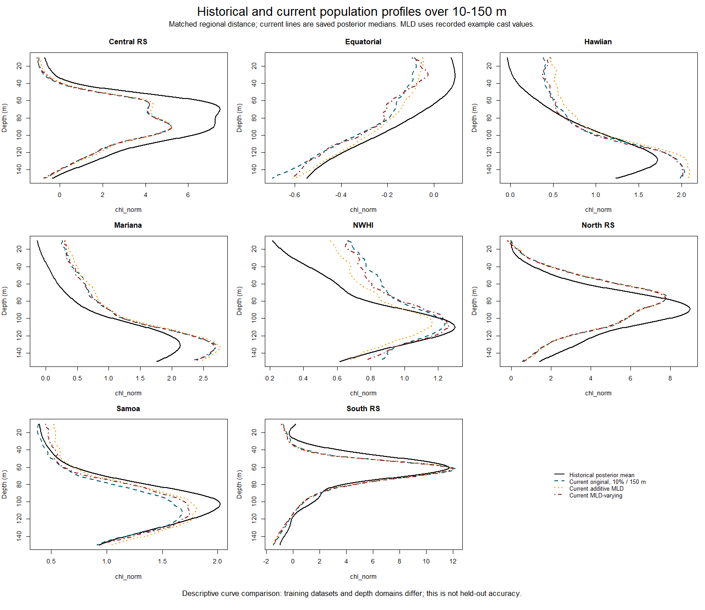
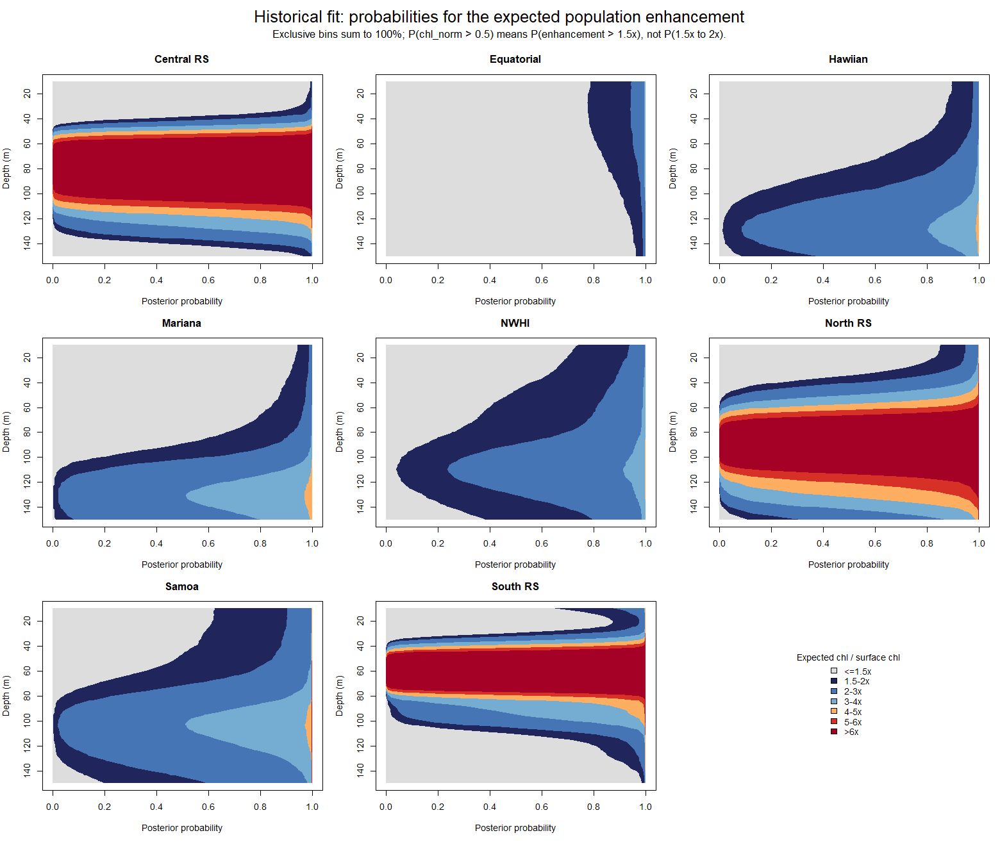

# Original saved fit and comparison with current results

The attached R Markdown was inspected as source text. Its chunks were not executed as a pipeline: it contains repeated alternative preparation/smoothing/binning and fitting sections, local Windows paths and package installation commands. The saved `my_model_50_FINAL.rds` is the authoritative evidence for what the original fitted object actually contains. The accompanying RData was inspected and contains a `fit_fixed_inter` brmsfit object; it was not treated as an additional independent experiment.

## What the original fit shows

| Item | Saved result |
| --- | ---: |
| Observations | 255,369 |
| Depth range | 10-250 m |
| Chains | 4 |
| Iterations per chain | 5,000 |
| Warmup per chain | 1,000 |
| Retained draws in all chains | 16,000 |
| adapt_delta | 0.97 |
| Configured max_treedepth | 14 |
| Largest observed post-warmup tree depth | 13 |
| Sampling divergences / tree-limit hits | 0 / 0 |
| Maximum rank-normalized R-hat | 1.001655 |
| Minimum bulk ESS | 3,680.014 |
| Minimum tail ESS | 6,854.821 |
| Minimum chain E-BFMI | 0.701435 |

The formula has Region, raw log10_distance, Region-specific cubic regression depth smooths with k=15, and the two nested date/ENSO random intercepts, with a Gaussian likelihood. MLD and cast identifiers are absent from this saved model's data. Date is a scaled numeric one-column matrix; its original calendar origin is not stored in the fit data. Population plots set nested group effects to zero, so they do not require reconstructing those dates.

The recorded four chain totals are about 10.1-10.9 days per chain on the original machine, including warmup. These times should not be used as a direct speed comparison with Ibex: machine, data size, depth domain and model configuration differ.

Posterior summaries include log10_distance coefficient -0.21009, residual sigma 1.48825, nested date SD 0.33434 and nested ENSO SD 0.68584. Their interpretation depends on this original dataset and specification. The saved fit has good sampling diagnostics; that alone does not establish predictive adequacy or identify the preferred scientific equation.

## Figures

This overlays original posterior mean curves with saved posterior median curves from the current original-equation 10% baseline and the longer additive-MLD/MLD-varying equation tests. The regional log-distance reference is identical across the three current curves, and the original posterior mean is adjusted exactly to that distance through its linear distance coefficient. Current MLD values are the recorded example-cast values. Group effects are zero. Training datasets and depth domains differ; these are descriptive curve comparisons, not a common validation ranking.

Several regions show similar broad vertical structure, while Central RS, North RS and Samoa show appreciable differences in peak height or depth. The targeted 250 m versus 150 m comparison holds training casts, priors and sampler settings fixed to help isolate one reason. It cannot by itself identify every original preprocessing or cohort difference.

The original normalization is `(Chl - surface_chl) / surface_chl`. Therefore `chl_norm > 0.5` means chlorophyll exceeds **1.5 times** surface chlorophyll. It does not mean the value lies between 1.5 and 2 times surface. The new plot uses exclusive probability bins that sum to one. Probabilities from `posterior_epred` concern the expected curve; new-observation exceedance probabilities include residual variation and are saved separately in new runs.

The package also contains `historical_profiles.png`, historical 10-150 m profile quantiles/exceedance probabilities, observed median profiles, all parameter diagnostics, per-chain sampler diagnostics and a bounded reconstruction sample. The bounded 640-observation training reconstruction had RMSE 2.407 and 90% coverage 0.930. It is not independent validation and should not be compared with held-out RMSE from a different cohort.

## Limits of a direct historical accuracy comparison

The original fit used a much larger and deeper dataset, and its saved data have no cast IDs or MLD. We cannot prove that a proposed validation cast was excluded from that fit. Its reconstruction scores and population curves therefore remain historical references. Completed current fits are rescored on a verified common holdout only after their training rows and raw values match the frozen subset and have no validation-cast overlap.

The R Markdown has alternative smoothing and 5 m binning paths, as well as an earlier subset operation. Their presence does not prove which chunks preceded the saved fit in an interactive session. The new workflow keeps the frozen unsmoothed, unbinned data unchanged and records every split, equation, prior and run setting to make future comparisons reproducible.

Historical prediction analysis read the already saved posterior samples; it did not refit the model. The local rstan DLL could not load, so read-only extraction used the hydrated sample slots and a temporary in-memory adapter for brms prediction access. Source fit files and posterior values were left untouched.
