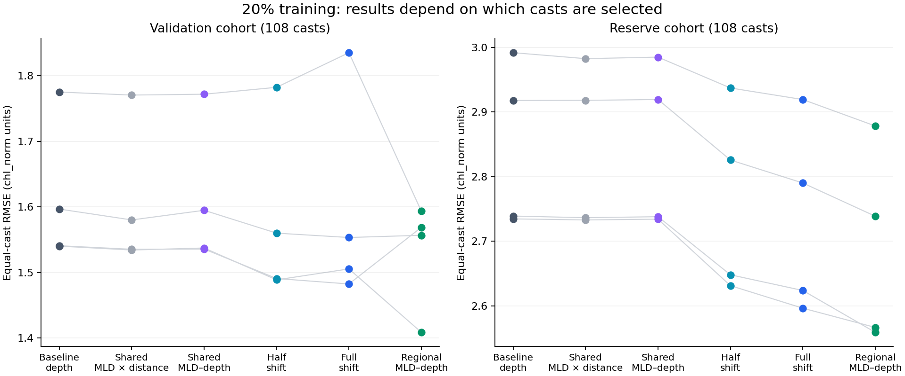

# DCM model: chlorophyll enhancement through the water column

This repository is the scientific and operational handover for Gage Mele's DCM modelling project at KAUST. It documents the question, original analyses, every recovered test campaign, the available results, and the Ibex system used to run them.

**Handover prepared: 27 October 2026. Latest verified result archive: 25 October 2026, 11:15 UTC.** The repository records that snapshot; it does not claim that the listed jobs are still running today. The first task for the next researcher is to refresh the existing Ibex campaign.

## Start here

1. [New researcher handover](docs/START_HERE.md): what to read, what to obtain, and the first safe commands.
2. [Scientific background](docs/SCIENTIFIC_BACKGROUND.md): what is being predicted and why MLD matters.
3. [Data and preprocessing](docs/DATA_AND_PREPROCESSING.md): response definition, joins, exclusions, whole-cast splits, and exact sample sizes.
4. [Equation catalogue](docs/EQUATIONS.md): mathematical and brms interpretations of all recovered model families.
5. [Priors and sampling](docs/PRIORS_AND_SAMPLING.md): historical and current settings, experimental changes, and interpretation.
6. [Campaign history](docs/CAMPAIGN_HISTORY.md) and [complete case catalogue](docs/CASE_CATALOGUE.md): the experiments and their exact configurations.
7. [What we have learned](docs/RESULTS_AND_INTERPRETATION.md): successes, negative results, qualifications, and unresolved questions.
8. [Evaluation methods](docs/EVALUATION.md): reconstruction, conditional/population predictions, onset, shape, uncertainty, and fair comparisons.
9. [Ibex operations](docs/IBEX_RUNBOOK.md): paths, environment, monitoring, recovery, and transfer commands.
10. [Ibex job inventory](docs/CURRENT_JOBS.md): all archived active candidates and a live capture command.
11. [Known problems and repairs](docs/KNOWN_ISSUES.md), [next decisions](docs/NEXT_STEPS.md), [provenance](docs/PROVENANCE.md), and [glossary](docs/GLOSSARY.md).

## Project in one page

The response is fractional enhancement relative to each cast's surface chlorophyll:

`chl_norm = (Chl - surface_chl) / surface_chl`

The current preparation defines `surface_chl` as the median of raw chlorophyll observations at 5–15 m. A response of 0 is the surface baseline; 0.5 is 50% enhancement; 1 is twice the surface concentration. The raw profile is **not smoothed or binned for fitting**. Earlier notebooks contain different preprocessing and percentage conventions; see the data history before reusing them.

The scientific goal is to reproduce vertical chlorophyll structure using depth, mixed-layer depth (MLD), distance from shore, and Region, controlling for nested date and ENSO groups. MLD may alter the onset, position, height, width, and steepness of the enhancement. A simple depth shift tests only one part of that hypothesis.

The latest campaign fits the prepared **10–150 m** interval using **1,080 eligible whole casts / 151,962 observations** at full size. It has 282 cases: 270 posterior fits and 12 prior-only checks, including 11 planned full-data fits. It compares 10%, 20%, 40%, 50%, 75%, and 100% training fractions, repeated 20% cast selections, several MLD representations, and depth basis dimensions 7–15.

At the October 25 snapshot, 67 new posterior fits and 12 prior checks were complete. The combined registry held 586 entries across all campaigns. These are registrations/evaluations, **not 586 independent completed models**. Reused controls, incomplete entries, and prior checks remain visible.

The strongest completed 20% candidate for overall conditional profile RMSE allows **Region-specific depth-dependent MLD effects**. Half-shift remains an important onset comparator. Neither has solved sharpness, peak location, residual dependence, or final generalization. The regional tensors and all new 40–100% fits were unfinished in the snapshot.

The main working configuration is four chains, 1,000 warmup plus 2,000 retained draws per chain, `adapt_delta = 0.97`, and `max_treedepth = 14`, with regional residual SD. This is provisional, not a universal optimum.

A fresh Ibex SSH connection was blocked during publication. The [job inventory](docs/CURRENT_JOBS.md) is explicitly dated; current RUNNING jobs require the included live capture.

## Available evidence

- [October 25 scientific review](results/20261025/README.md)
- [All 586 registrations, full fields](results/20261025/all_586_registrations.csv)
- [Compact all-run index](results/20261025/run_index.csv)
- [All 282 shape cases](results/20261025/all_282_new_cases.csv)
- [All 67 completed new posterior runs](results/20261025/all_67_completed_posterior_runs.csv)
- [344 independently recomputed planned comparisons](results/20261025/paired_comparisons_common_casts.csv)
- [Actual frozen shape campaign](evidence/shape_20261025/campaign/)
- [Per-run configuration, priors, hardware, sessions and summaries](evidence/shape_20261025/runs/)
- [Earlier review findings](results/20261021/review_findings.csv)
- [Original saved-model review](DCM_Ibex_targeted_tests/ORIGINAL_REVIEW.md)



These repeatedly inspected validation and reserve cohorts are development sets. A final assessment needs a new grouped test design.

## Repository layout and execution boundary

`DCM_Ibex_*` directories preserve delivered workflow/campaign packages. Their local README, PLAN and case tables are part of the methods record. The root launchers are historical deployment artifacts. **Some submit many expensive jobs when executed.** Cloning or reading this repository starts no work.

`evidence/` preserves selected actual cluster outputs. `results/` preserves dated reviews. `archive/` holds original notebooks, analysis and package-building provenance. `provenance/` records source paths and checksums.

Raw CTD/MLD inputs, prepared RDS bundles, fitted objects, persistent chain CSVs, and the full 77.8 MB comparison archive remain external. See [required external assets](docs/EXTERNAL_ASSETS.md). This is a detailed continuation record, not a self-contained data release or a bit-for-bit environment image. No data/code licence is inferred from making this repository public.

## Continuing the existing campaign

Run in an authenticated Ibex Bash session, not Windows PowerShell:

```bash
cd /ibex/user/meleg/DCM_MODEL
experiment=$(cat logs/latest_shape150_experiment.txt)
python3 "$experiment/scheduler.py" status "$experiment"
bash DCM_Ibex_shape_tests/monitor_all_dcm_v8.sh --diagnostics
```

Read the [runbook](docs/IBEX_RUNBOOK.md) before restarting anything. The archived launcher predates a collector identifier repair; the patched cluster snapshot and recovery notes are retained separately.

Changes to documentation do not refit models, alter the cluster, or update its queue. To keep this handover current, follow [CONTRIBUTING.md](CONTRIBUTING.md).
