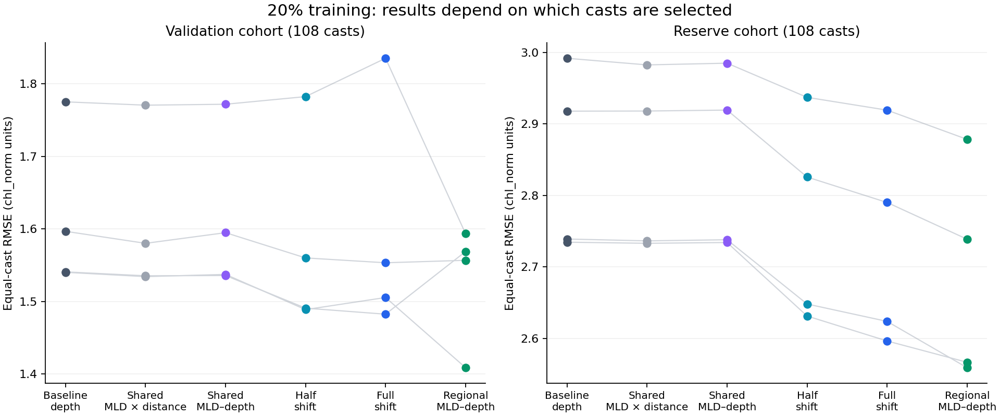

# DCM model: chlorophyll enhancement through the water column

This repository is the scientific and operational handover for Gage Mele's DCM modelling project at KAUST. It documents the question, original analyses, every recovered test campaign, the available results, and the Ibex system used to run them.

**Handover updated: 15 November 2026. Latest scientific evidence: 15 November 2026** (next150, round3 and bins1m campaigns, plus posterior predictive plots of the top setups). The previous handover was dated 27 October 2026; everything from it is kept below and in the dated folders.

**Current best setup:** a **lognormal half-shift model** on `ratio = chl_norm + 1`, with regional `s(depth − 0.5·MLD, by = Region, k = 7)`, distance, nested date and ENSO intercepts, and `sigma ~ 0 + Region`. It has the best held-out score on dates the model never saw. The **lognormal Gaussian-peak profile** model is best on sampled dates and the most interpretable, but its unseen-date fit has not converged yet. See [current best models](docs/BEST_MODELS.md) and [what has been tried and what has not](docs/TRIED_AND_UNTRIED.md).

## Start here

1. [New researcher handover](docs/START_HERE.md): what to read, what to obtain, and the first safe commands.
2. [Current best models](docs/BEST_MODELS.md) and [tried vs untried](docs/TRIED_AND_UNTRIED.md): the short answer to "where are we".
3. [Scientific background](docs/SCIENTIFIC_BACKGROUND.md): what is being predicted and why MLD matters.
4. [Data and preprocessing](docs/DATA_AND_PREPROCESSING.md): response definition, joins, exclusions, whole-cast splits, and exact sample sizes.
5. [Equation catalogue](docs/EQUATIONS.md): mathematical and brms interpretations of all recovered model families.
6. [Priors and sampling](docs/PRIORS_AND_SAMPLING.md): historical and current settings, experimental changes, and interpretation.
7. [Campaign history](docs/CAMPAIGN_HISTORY.md) and [complete case catalogue](docs/CASE_CATALOGUE.md): the experiments and their exact configurations.
8. [What we have learned](docs/RESULTS_AND_INTERPRETATION.md): successes, negative results, qualifications, and unresolved questions.
9. [Evaluation methods](docs/EVALUATION.md): reconstruction, conditional/population predictions, onset, shape, uncertainty, and fair comparisons.
10. [Ibex operations](docs/IBEX_RUNBOOK.md): paths, environment, monitoring, recovery, and transfer commands.
11. [Ibex job inventory](docs/CURRENT_JOBS.md): the 15 November experiment status, plus the 27 October capture of all 335 queue entries and the 19 DCM fits then running.
12. [Known problems and repairs](docs/KNOWN_ISSUES.md), [next decisions](docs/NEXT_STEPS.md), [provenance](docs/PROVENANCE.md), and [glossary](docs/GLOSSARY.md).
13. [Literature-based test design](docs/research/TEST_DESIGN_20261027.md) (27 October 2026) and its [background notes](docs/research/): the reasoning behind the next150 tests and the untested T8–T14.

## Project in one page

The response is fractional enhancement relative to each cast's surface chlorophyll:

`chl_norm = (Chl - surface_chl) / surface_chl`

The current preparation defines `surface_chl` as the median of raw chlorophyll observations at 5–15 m. A response of 0 is the surface baseline; 0.5 is 50% enhancement; 1 is twice the surface concentration. The raw profile is **not smoothed**. All campaigns to October fit raw 1 m rows. From 28 October, fitting on each cast's 5 m bin medians was tested as a faster option (about 35× faster, same accuracy). Those fits are still scored on the raw rows. Earlier notebooks contain different preprocessing and percentage conventions; see the data history before reusing them.

The scientific goal is to reproduce vertical chlorophyll structure using depth, mixed-layer depth (MLD), distance from shore, and Region, controlling for nested date and ENSO groups. MLD may alter the onset, position, height, width, and steepness of the enhancement. A simple depth shift tests only one part of that hypothesis.

The large shape150 campaign fits the prepared **10–150 m** interval using **1,080 eligible whole casts / 151,962 observations** at full size. It has 282 cases (270 posterior fits and 12 prior-only checks) comparing training fractions of 10–100%, repeated 20% cast selections, MLD representations and depth bases k7–15. By 15 November, 195 of its fits were complete and 48 had failed. The results collected so far end on 27 October, and the 48 failures have not been examined.

Three newer campaigns ran at 20% training (216 casts, about 30k rows). Each was tested on two holdouts: held-out casts from **seen** dates (primary split) and from **unseen** dates (date-blocked split, seed 20261022). Each case is scored by joint per-date held-out log predictive density (elpd) as well as RMSE, coverage and onset error.

- **next150** (23 cases, 28 Oct–9 Nov) tested a lognormal likelihood, sigma by depth, date-only groups, Pedersen GI pooling, pooled regional MLD, distance by depth, a nonlinear Gaussian-peak profile and 5 m binning. It also rescored seven shape150 anchors. **The lognormal likelihood was by far the largest gain:** elpd improved by about 5,600 on seen dates and 4,500 on unseen dates.
- **round3** (16 cases, from 9 Nov) refitted the next150 models with a Gaussian likelihood, and added depth-bin ("histogram") models at 5 m: bin means, ordinal enhancement class, and ordinal DCM depth. Sigma by depth rescues much of the Gaussian deficit, but no Gaussian model beats its lognormal counterpart. One case was still fitting on 15 November.
- **bins1m** (8 cases, 9–12 Nov) refitted the histogram models with every metre as its own bin. The lognormal 1 m histogram had the lowest RMSE of any model (1.401) but generalised poorly to unseen dates.

The 15 November posterior predictive plots show the following. The lognormal models get DCM depth and shape right in every region, but predict strong peaks at about half their size on new dates. They are close to calibrated on seen dates. On unseen dates they are overconfident and too high below about 60 m.

The previous working configuration, regional MLD-varying Gaussian (shape150 34/129), had the best seen-date RMSE but did not generalise to unseen dates. Sampler settings are now 4 chains × (1,000 warmup + 2,000 retained), `adapt_delta = 0.95` and `max_treedepth = 14`.

## Available evidence

- [15 November review: ranking, plots, peak-profile posterior](results/20261115/README.md)
- [9 November next150 results](results/20261109/README.md)
- [next150](DCM_Ibex_next150/README.md), [round3](DCM_Ibex_round3/README.md), [bins1m](DCM_Ibex_bins1m/README.md) and [plotting](DCM_Ibex_plots_top5/README.md) packages
- [Run log, 27 Oct–15 Nov](operations/RUN_LOG_20261027_20261115.md) and [Ibex helper scripts](operations/scripts/README.md)
- [October 25 scientific review](results/20261025/README.md)
- [All 586 registrations, full fields](results/20261025/all_586_registrations.csv)
- [Compact all-run index](results/20261025/run_index.csv)
- [All 282 shape cases](results/20261025/all_282_new_cases.csv)
- [All 67 completed new posterior runs](results/20261025/all_67_completed_posterior_runs.csv)
- [344 independently recomputed planned comparisons](results/20261025/paired_comparisons_common_casts.csv)
- [Actual frozen shape campaign](evidence/shape_20261025/campaign/)
- [Per-run configuration, priors, hardware, sessions and summaries](evidence/shape_20261025/runs/)
- [Earlier review findings](results/20261021/review_findings.csv)
- [Original saved-model review](DCM_Ibex_targeted_tests/ORIGINAL_REVIEW.md)



These repeatedly inspected validation and reserve cohorts are development sets. A final assessment needs a new grouped test design.

## Repository layout and execution boundary

`DCM_Ibex_*` directories preserve delivered workflow/campaign packages. Their local README, PLAN and case tables are part of the methods record. The root launchers are historical deployment artifacts. **Some submit many expensive jobs when executed.** The same holds for the installers `04`–`07` in the newer packages, which create a new experiment and submit its controller. `09_plot_top5.sh` submits only read-only plotting jobs, and the helper scripts in `operations/scripts/` are read-only except `03_restart_checks_only.sh`. Cloning or reading this repository starts no work.

`evidence/` preserves selected actual cluster outputs. `results/` preserves dated reviews. `archive/` holds original notebooks, analysis and package-building provenance. `provenance/` records source paths and checksums.

Raw CTD/MLD inputs, prepared RDS bundles, fitted objects, persistent chain CSVs, and the full 77.8 MB comparison archive remain external. See [required external assets](docs/EXTERNAL_ASSETS.md). This is a detailed continuation record, not a self-contained data release or a bit-for-bit environment image. No data/code licence is inferred from making this repository public.

## Continuing the existing campaigns

Run in an authenticated Ibex Bash session, not Windows PowerShell:

```bash
cd /ibex/user/meleg/DCM_MODEL
bash 08_status_all.sh 2>&1 | tee logs/status_all.txt      # round3 + bins1m + shape150 counts
for n in shape150 next150 round3 bins1m; do echo "$n: $(cat logs/latest_${n}_experiment.txt)"; done
experiment=$(cat logs/latest_shape150_experiment.txt)
python3 "$experiment/scheduler.py" status "$experiment"
```

The status script is in [operations/scripts](operations/scripts/08_status_all.sh).

Read the [runbook](docs/IBEX_RUNBOOK.md) before restarting anything. The archived launcher predates a collector identifier repair; the patched cluster snapshot and recovery notes are retained separately.

Changes to documentation do not refit models, alter the cluster, or update its queue. To keep this handover current, follow [CONTRIBUTING.md](CONTRIBUTING.md).
