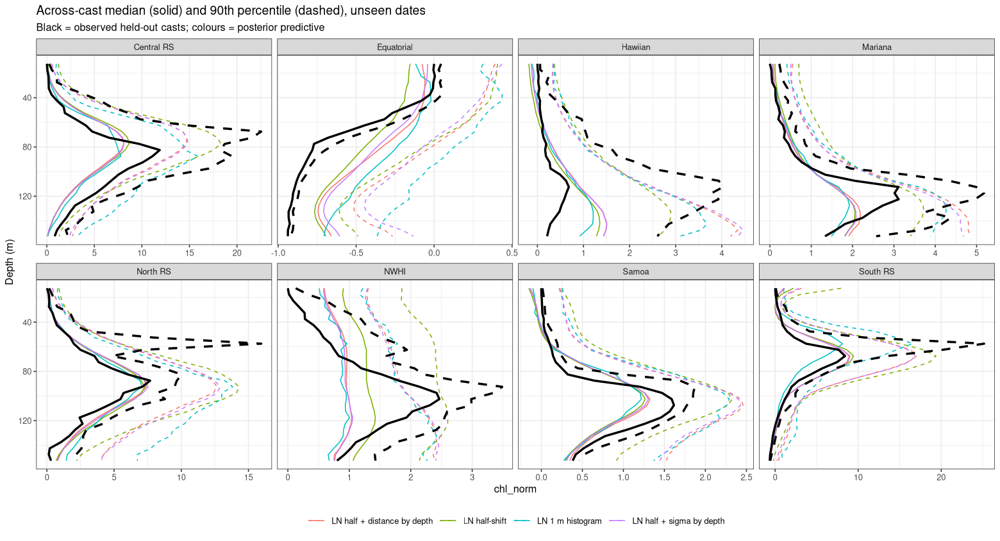
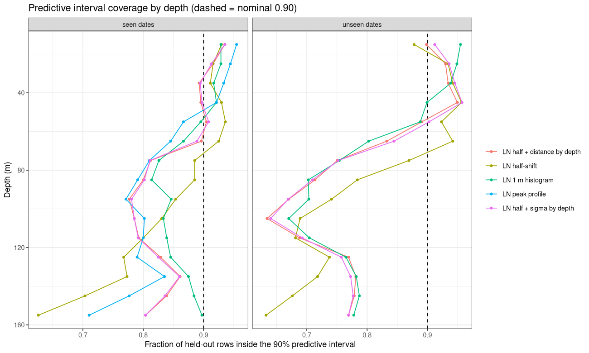
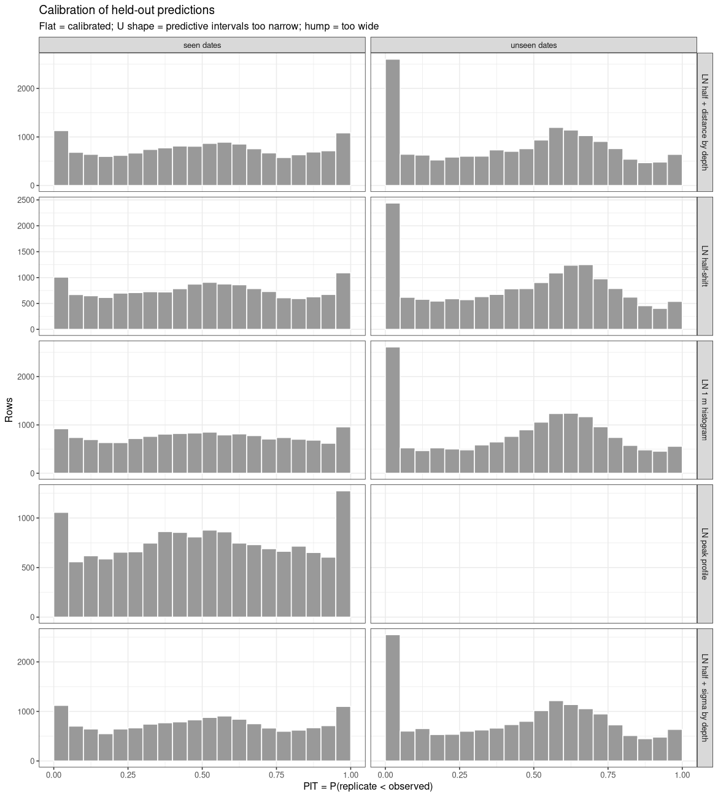

# 15 November 2026 review: next150, round3, bins1m and posterior plots

**Evidence cutoff: 15 November 2026, 18:00 UTC.** Sources:
- the next150 results, all 23 cases checked by 9 Nov ([results/20261109](../20261109/README.md));
- the `08_status_all.sh` outputs of 12, 14 and 15 Nov for round3 and bins1m;
- the top-5 posterior plots (Slurm 55624665/55624666, folder `plots/top5_20261115T155349Z` on Ibex).

The numbers come from each run's `test_summary.csv`, `diagnostic_summary.csv` and `checks/` files, as printed on Ibex. Full fitted objects remain on Ibex.

| File | Content |
|---|---|
| [overall_summary_2026-11-15.md](overall_summary_2026-11-15.md) | Ranking of every continuous model so far, and which changes mattered |
| [round3_bins1m_2026-11-12.md](round3_bins1m_2026-11-12.md) | All round3 and bins1m case scores (status updated 15 Nov) |
| [plots_review_2026-11-15.md](plots_review_2026-11-15.md) | What the posterior predictive plots show, with suggested next tests |
| [top5_plots/compare/](top5_plots/compare/) | Side-by-side figures and `heldout_summary.csv` |
| `top5_plots/<tag>/` | Per model: parameter posteriors (`parameters.png`, `parameter_summary.csv`), held-out quantile profiles (CSV) and example held-out profiles (`validation_profiles.png`) |

Every per-model figure (PIT, densities, observed vs predicted, training-set versions) is on Ibex in `plots/top5_20261115T155349Z/`. The code is in [DCM_Ibex_plots_top5](../../DCM_Ibex_plots_top5/).

## Definitions used throughout

- **Seen dates:** the primary p20 split (`primary_p20_frozen`). It holds out 108 casts from dates that also appear in training.
- **Unseen dates:** the date-blocked p20 split (seed 20261022). It holds out 117 casts from dates that never appear in training. This is the generalisation test.
- **elpd:** the joint log predictive density per held-out date group, summed, on the chl_norm scale. Higher is better. It is comparable across lognormal and Gaussian fits (`ratio` is a pure shift, so no Jacobian is needed), but only within one split. No standard errors have been computed yet, so treat gaps of a few hundred as uncertain.
- **cov90:** the fraction of held-out rows inside the 90% posterior predictive interval.
- **PIT:** P(replicate < observed). It should be uniform; the expected fraction in each 5% tail is 0.05.

## Ranking of continuous chl_norm models

| Rank | Setup | Seen elpd | Unseen elpd | Unseen cov90 | Fit h |
|---|---|---|---|---|---|
| 1 | **Lognormal half-shift** (next150 1/2) | −11,554 | **−14,573** | 0.82 | 12–17 |
| 2 | LN half + sigma by depth + distance by depth (next150 11/12) | −10,823 | −14,852 | 0.81 | 13 |
| 3 | LN half + sigma by depth (next150 3/4) | −10,981 | −15,097 | 0.81 | 15–19 |
| 4 | LN pooled GI shape + sigma by depth (next150 7/8) | −10,913 | −15,107 | 0.81 | 58–60 |
| 5 | **LN peak profile** (next150 13/14) | **−9,001** | not converged | – | 9 / 54 |
| 6 | LN 1 m histogram bin means (bins1m 7/8) | −10,466 | −18,181 | 0.81 | 14–19 |
| 7 | LN pooled regional MLD + sigma by depth (next150 9/10) | −11,110 | −18,964 | 0.84 | 124 / 78 |
| 8 | Gaussian half + sigma by depth (round3 7/8) | −13,550 | −16,965 | 0.88 | 18–31 |
| – | Gaussian half (shape150 25/267; baseline) | −17,134 | −19,107 | 0.95 | 27–29 |
| – | Gaussian half, 5 m bins (next150 22/23) | −16,235 | −18,619 | 0.925 | 0.8–0.9 |

## What made a substantial difference

1. **The lognormal likelihood (`ratio = chl_norm + 1`) gave the largest gain.** Elpd improves by about 5,600 on seen dates and 4,500 on unseen dates, and RMSE and onset error also improve. No predictive draws fall below chl_norm = −1. The cost is that the 90% intervals are too narrow, covering only 81–86% of rows.
2. **Sigma by depth** (`sigma ~ 0 + Region + s(depth, by = Ocean, k = 5)`) is large for Gaussian models: about +3,600 on seen dates and +2,100 on unseen. For lognormal models it helps seen dates (+570) but hurts unseen dates (−520).
3. **The peak-profile equation** gives +2,550 over the LN half-shift on seen dates at less cost (8.6 h). It does not yet have a converged unseen-date fit.
4. **5 m binning of the training rows** is about 35× faster with the same accuracy. This is a speed gain, not an accuracy gain.

Changes that did **not** help: pooled GI shape; pooled regional MLD (−3,900 on unseen dates at 78–124 h); dropping ENSO (same elpd, unseen onset error 18.7 vs 11.2 m); 1 m bins vs 5 m bins; the Gaussian peak profile (R-hat 1.32 and 1.10).

Distance by depth is roughly neutral. Against its own reference (sigma by depth) it gains about 160 on seen dates and 245 on unseen dates, which is within the likely noise.

## What the posterior plots show

- **The four smooth lognormal models give nearly identical mean profiles.** The 1 m histogram follows the same curves but is noisy from metre to metre. The elpd differences come from interval width, not from the predicted shape.
- **DCM depth and shape are right in all 8 regions, but strong peaks are predicted at about half their size.** For example, Central RS is 22 observed vs 9–10 predicted, Mariana 5 vs 2.5 and Hawaiian 4 vs 2. On a new date the model falls back to the regional average peak.
- **Seen dates are close to calibrated:** cov90 is 0.85–0.87, with a mild U-shaped PIT (6–8% in each tail).
- **Unseen dates fail below about 60 m.** Coverage is 0.90–0.95 above 50 m but falls to 0.63–0.78 below 60 m. About 15% of rows sit below the 5th percentile, against only 3.5% above the 95th. The models over-predict enhancement at depth on new dates. The clearest case is Equatorial, where the observed median drops to chl_norm ≈ −0.9 below 80 m while the models predict −0.5 to −0.75. Those casts should be checked in the raw data.
- **Every model misses two features of the observed distribution.** One is a sharp spike at Chl = surface (ratio 1), from mixed-layer rows. The other is a low tail at 3–30% of surface, seen only on unseen dates.
- **The plain half-shift wins on unseen dates because its intervals are wider at depth,** not because its means are better.

| Model | Split | RMSE | cov50 | cov90 | 90% width | PIT < 0.05 | PIT > 0.95 |
|---|---|---|---|---|---|---|---|
| LN half-shift | seen | 1.378 | 0.523 | **0.859** | 1.33 | 0.063 | 0.072 |
| LN + sigma by depth | seen | 1.358 | 0.514 | 0.852 | 1.10 | 0.070 | 0.072 |
| LN + sigma by depth + distance by depth | seen | **1.357** | 0.514 | 0.852 | 1.10 | 0.071 | 0.071 |
| LN 1 m histogram | seen | 1.402 | 0.516 | **0.873** | 1.23 | 0.056 | 0.063 |
| LN peak profile | seen | 1.412 | 0.513 | 0.845 | 0.95 | 0.067 | 0.084 |
| LN half-shift | unseen | 1.848 | 0.538 | **0.818** | 1.82 | 0.145 | 0.033 |
| LN + sigma by depth | unseen | 1.839 | 0.531 | 0.805 | 1.55 | 0.152 | 0.039 |
| LN + sigma by depth + distance by depth | unseen | **1.837** | 0.521 | 0.801 | 1.56 | 0.155 | 0.039 |
| LN 1 m histogram | unseen | 1.855 | 0.546 | 0.807 | 1.73 | 0.156 | 0.034 |

## Peak-profile posterior: how MLD acts on the DCM

The posterior is from next150 case 13 (seen dates; the converged fit). Every R-hat is ≤ 1.002. Depth inside the model is `z = (depth - 0.5*MLD)/100`, so the half-shift is already imposed.

| Parameter | Posterior median [90% interval] | Meaning |
|---|---|---|
| `zm ~ mld_z` | 0.005 [−0.002, 0.012] | Extra DCM displacement per SD of MLD, beyond the half-shift: about 0.5 m. The data are consistent with the half-shift coefficient of 0.5. |
| `lamp ~ mld_z` | −0.078 [−0.097, −0.058] | Deeper MLD lowers peak amplitude by about 7.5% per SD. This is erosion or dilution. |
| `lwid ~ mld_z` | −0.031 [−0.041, −0.021] | Deeper MLD narrows the peak by about 3% per SD. This is weak support for Gage's sharpening hypothesis. |
| `lamp ~ distance_z` | −0.076 [−0.083, −0.069] | Smaller relative peak farther from shore, consistent with an island-mass effect |
| `sd(date)` on `lamp` | 0.68 [0.60, 0.77] | Peak amplitude varies about ×2 between dates. This is why peak size is under-predicted on unseen dates. |
| `sd(date)` on `zm` | 0.28 [0.25, 0.32] | DCM depth varies about ±28 m between dates |

Regional DCM depths (`zm`, in units of 100 m on the half-shift scale) range from 0.16 (Equatorial) to 1.20 (Mariana). Regional peak amplitudes (`lamp`) are largest in the Red Sea: Central 2.0, South 1.8, North 1.7.

## Suggested next tests (not yet run)

1. **A date effect that varies with depth,** for example a date-level slope or smooth on depth relative to MLD. This targets the deep under-coverage and the PIT spike on unseen dates.
2. **Sigma as a function of depth relative to MLD,** with small values inside the mixed layer. This targets the ratio = 1 spike.
3. **Fix the date-blocked peak profile,** using tighter priors, initial values from case 13, and/or fitting only DCM-present casts.
4. **Check the Equatorial casts** that drop to near-zero Chl below 80 m.
5. **Paired elpd differences with date-bootstrap SEs** from each run's `checks/*_date_elpd.csv`.

The complete list of tried and untried ideas is in [docs/TRIED_AND_UNTRIED.md](../../docs/TRIED_AND_UNTRIED.md).
